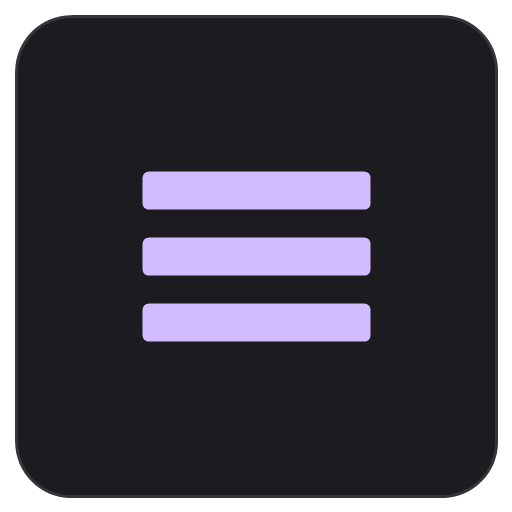

<p align="center">
  
</p>

<h1 align="center">Drawer</h1>

<p align="center"><strong>A minimal Android launcher designed for focus, speed, and privacy.</strong></p>
<p align="center">
  <em>Replace grid layouts with categorized drawers and fast navigation.</em>
</p>

<p align="center">
  <a href="https://github.com/urunkarpm/drawer/releases"></a>
  <a href="LICENSE"></a>
  
  
  
</p>

---

## Overview

<!-- ponytail: Concise technical summary without promotional copy. Ceiling: lacks narrative marketing prose. Upgrade path: add a dedicated product landing page if the project requires marketing copy. -->

Standard mobile launchers display advertisements, news feeds, and notification badges. These items cause distractions.

Drawer uses a simple structure. You can access tools in less than one second. The interface hides unused applications.

---

## What's New in v2.10.9

* **Contextual Task Creation:**
  * Redesigned the task creation sheet with responsive selectors for dates, times, and priority levels.
* **Geofence Distance Presets:**
  * Added distance preset buttons (50m, 100m, 250m, 500m, 1km) in the place picker for rapid location alerts.
* **App Vault Privacy Filtering:**
  * The launcher excludes vaulted apps from the main app drawer, search results, and alphabet scrub rail.
* **Alphabet Scrub Rail Improvements:**
  * Added continuous pointer input tracking and row-aligned scrolling in the alphabet index bar.

---

## What's New in v2.10.4

* **Interactive Features Discovery:**
  * Added an interactive feature guide and gesture overview in **Settings -> Features**.
* **Predictive Back Navigation:**
  * Integrated Android 14 predictive back gesture support for closing drawers and bottom sheets.
* **120Hz Drawer Rendering:**
  * Tuned scroll velocity handoff and reduced drag thresholds for 120Hz displays.

---

## What's New in v2.10.3

* **Monochrome Theme:**
  * Added a unified monochrome high-contrast theme for minimal visual distractions.
* **Notification Listener Recovery:**
  * Added automatic service re-binding to recover notification access on devices with aggressive battery managers.
* **Automated Background Updates:**
  * Added periodic 24-hour update checks using WorkManager with system alerts when a release is available.

---

## What's New in v2.10.2

* **Fast Outside-Touch Drawer Collapse:**
  * Touching or swiping outside an open drawer closes the drawer on `ACTION_DOWN`. You do not need to wait for finger release or timers.
  * The touch handler prevents unintended app launches from the dock or wallpaper.
* **Vault App Restoration and Safe Disable:**
  * Disabling the Vault feature restores all hidden apps to the main drawer, dock, and category groups.
  * Notifications from restored apps return to the primary notification drawer.
* **Multi-Select Vault Hiding:**
  * Added multi-selection in the Vault. Select multiple apps with checkboxes and hide them with one tap.
* **Dedicated Vault Notification Drawer:**
  * Added a dedicated notification drawer inside the Vault. This drawer displays alerts from hidden apps only.
  * The main notification drawer displays a subtle glow indicator on the caret when private notifications wait.
* **Performance Optimization:**
  * Moved caret glow animations to the GPU draw phase with `.drawBehind` to maintain 120 frames per second.
  * Added content-type recycling to the Vault grid.
* **Calibrated Elastic Vault Swipe:**
  * Calibrated dock elastic resistance to trigger with a 28dp thumb swipe.
  * Authentication triggers on swipe completion (`onDragEnd`).
  * Added touch event consumption on the Vault card to prevent touches from leaking to the background scrim.
  * Locked `HorizontalPager` scrolling while the Vault is open to eliminate page interference.

---

## What's New in v2.10.0

* **Hidden Drawer (App Vault):**
  * Added an encrypted app vault. Swipe horizontally from the last app in the dock to open the vault.
  * Includes elastic resistance physics and progressive haptic feedback.
  * Protects apps with the Android `BiometricPrompt` API using `BIOMETRIC_STRONG` or `DEVICE_CREDENTIAL`.
* **Zero-Trace Privacy:**
  * The launcher removes hidden apps from the main app drawer, categories, dock, and search results.
* **Notification Privacy:**
  * The launcher hides notifications for vaulted apps from the notification drawer and status badges.
  * A subtle glow indicator on the bell icon alerts you to pending private notifications during device unlock.
* **Screen Curve Detection:**
  * Detects physical screen corner radii on Android 12 and higher with the `RoundedCorner` API.
  * Added a toggle in Settings to match the device screen curve.
  * Added a manual offset slider (`-12dp` to `+12dp`) to align drawer borders with phone cases and screen protectors.
* **App Drawer Visual Styles:**
  * Added visual style presets in **Settings -> Surface and Appearance -> App Drawer Look**.
  * Choose **Solid**, **Translucent**, or **Frosted** styles.
* **Widget Drawer Gestures:**
  * Fixed an issue where swiping outside an open widget drawer failed to return to the home screen.

---

## Core Features

```
  Traditional Launchers                     Drawer Launcher
 ┌──────────────────────┐                  ┌──────────────────────┐
 │ [App] [App] [App]  🔴│  Visual Clutter  │      09:41 AM        │  Glance Header &
 │ [App] [App] [App]  🔴│  Badge Overload  │  22°C ☀️  45W Turbo  │  Battery Statistics
 │ [App] [App] [App]  🔴│  News Feed       │                      │
 │ ── Page 1 of 6 ──────│  Excessive Pages │ ┌──────────────────┐ │  Single Focus Area
 │ 🔍 Sponsored search  │  Ad Tracking     │ │ 📁 Work (4 apps) │ │  Expandable Drawer
 └──────────────────────┘                  │ └──────────────────┘ │
                                           │   [ 📞  💬  🌐 ]     │  Dock Bar
                                           └──────────────────────┘
```

### 1. Accordion Drawers
Organize tools by task workflow instead of spreading apps across multiple screen pages:
* **Workflow Groups:** Group apps into expandable categories such as **Work**, **Communication**, **Finance**, and **Tools**.
* **Single-Tap Actions:** Tap once to expand a category. Tap again to collapse it. Other drawers stay closed.
* **Multi-Drawer Placement:** You can add an app to multiple categories without creating duplicate shortcuts.
* **Auto-Collapse:** Drawers collapse automatically when you navigate away from them.

### 2. Widget Drawers and 3D Cover Flow
Widgets remain accessible without filling your primary screen:
* **Cover Flow Stacking:** Swipe horizontally through interactive widgets with hardware-accelerated depth effects.
* **Collapsible Widget Drawers:** Place widgets inside collapsible drawers. Open a widget with one tap and let it collapse automatically.
* **Widget Resizing:** Adjust widget heights and column spans to match your layout requirements.
* **Lifecycle Management:** Custom lifecycle hooks prevent widget freezing and memory leaks.

### 3. Rapid App Launching
* **Frecency Engine:** Displays frequent apps dynamically using launch frequency and recency calculations.
* **Type-to-Filter Search:** Type a letter to filter and launch target apps immediately.
* **Alphabet Scroll Rail:** Slide your thumb along the screen edge to navigate directly to any letter index.
* **Hidden App Vault:** Hide sensitive apps behind biometric authentication.

### 4. Notification Hub and Quick Mute
* **Swipe-Up Notification Hub:** Displays notifications grouped by application.
* **Quick Mute:** Mute noisy apps for 1 hour, 24 hours, or indefinitely directly from the launcher.
* **Privacy Mask Mode:** Masks message previews on the home screen to protect private communications.

### 5. Power Telemetry and Speed Test
* **Battery Telemetry:** Tap the status icon to see real-time charging wattage, voltage, current, and temperature.
* **Network Speed Test:** Run download speed tests using Google Edge CDN and Cloudflare from the status panel.
* **Dock Bar:** Pin 1 to 5 primary apps in a bottom navigation bar.
* **Mirror Glance:** Tap the front-camera glance widget to inspect your video feed quickly without launching the camera app.

### 6. Offline Privacy and Performance
* **No Analytics:** Drawer contains zero telemetry, zero analytics tracking, and zero cloud synchronization. All data remains on the device.
* **Low Resource Usage:** Built with Jetpack Compose for fast redraw cycles, AMOLED black themes, and minimal battery consumption.

---

## Feature Comparison

| Capability | Stock Launchers | Other Third-Party | Drawer |
| :--- | :--- | :--- | :--- |
| **Design Goal** | Content feeds and store links | Layout customization | Task focus and speed |
| **Organization** | Fixed icon grids and folders | Multi-page grid layouts | Accordion drawers and widget stacks |
| **App Suggestions** | Sponsored recommendations | Recent app list | Local frecency calculation |
| **Battery Telemetry** | Percentage indicator only | Requires separate apps | Real-time wattage, voltage, and current |
| **Speed Test** | None | None | Integrated network speed test |
| **Notification Control** | Notification badges | Basic badge settings | Quick mute and preview masking |
| **Widget Support** | Full-page grid placement | Static placement | Collapsible widget drawers |
| **Custom Styling** | System defaults | Limited font options | Dynamic palettes and custom typography |
| **Data Privacy** | Cloud analytics and tracking | Crash analytics tracking | 100% offline with zero telemetry |
| **Configuration Time** | Variable | 30 or more minutes | Under 60 seconds |

---

## Installation and Setup

You can configure Drawer in less than one minute using the guided setup tour:

```
Step 1: Download and Install ───► Step 2: Set Default ───► Step 3: Organize Apps
Download app-release.apk          Press Home → Drawer      Create categories
```

### Option A: Install Pre-Built APK
1. Download [`app-release.apk`](app-release.apk) from this repository or the [GitHub Releases](https://github.com/urunkarpm/drawer/releases) page.
2. Open the file on your Android device and tap **Install**.
3. Press the **Home** button on your device.
4. Select **Drawer** and tap **Always**.
5. Complete the setup tour to configure your initial drawers.

### Option B: Build from Source
To build the application from source code:

```bash
# Clone the repository
git clone https://github.com/urunkarpm/drawer.git
cd Drawer

# Build the release APK with Gradle
./gradlew assembleRelease

# Gradle outputs the APK at:
# app/build/outputs/apk/release/app-release.apk
```

Install to a connected device with ADB:
```bash
adb install -r app/build/outputs/apk/release/app-release.apk
```

---

## Visual Customization Options

Customize the launcher appearance in Settings:
* **Wallpaper Studio:** Generate procedural wallpapers with color harmonies, duotones, and grain effects.
* **Typography Packs:** Select clock fonts including Google Sans, DS-Digital, Evil Empire, Hypik, Spookyy, and Texas Troupe.
* **App Label Scaling:** Adjust label text sizes across groups, the dock, and the app drawer using `LocalAppLabelScale`.
* **AMOLED Black Theme:** High-contrast dark theme designed to minimize battery usage.
* **Material You Theming:** Automatically adapts accent colors based on the current wallpaper.
* **Icon Packs:** Supports icon packs from Google Play and individual per-app icon overrides.
* **Adaptive Shapes:** Select squircle, circle, teardrop, or rounded square shapes for app icons.
* **Double-Tap Sleep:** Double-tap empty screen space to lock the device without breaking biometric unlock.
* **Backup and Restore:** Export your layout settings to a backup file and restore configuration in seconds.

---

## Architecture and Tech Stack

Drawer follows Google's Modern Android Development (MAD) architecture guidelines:

```
├── app/                  # Main application module, navigation & initialization
├── core/
│   ├── common/           # Coroutine dispatchers, DrawerWidgetHostManager, utilities
│   ├── model/            # Pure domain models (AppDrawer, WidgetItem, DockItem)
│   ├── designsystem/     # UI components, Pantone wallpaper, typography
│   ├── database/         # Room database, DAOs, and persistence entities
│   ├── datastore/        # Jetpack Preferences DataStore for user preferences
│   └── data/             # Repositories reconciling DB, installed apps & frecency state
└── feature/
    ├── home/             # Main screen orchestrator, DuoStatusIcon, speed test & walkthrough
    ├── groups/           # App drawer accordion management & categorized grouping
    ├── dock/             # Dock bar and fast action bar
    ├── notifications/    # System notification listener, quick-mute & privacy masking
    ├── iconpacks/        # Icon pack parsing, caching & custom shape masking
    ├── todo/             # Gesture to-do engine, location alerts & task analytics
    └── settings/         # Visual customization, typography packs, backup & tour
```

* **UI Layer:** Jetpack Compose with Material 3 design tokens.
* **Asynchronous Streams:** Kotlin Coroutines and reactive `StateFlow` and `SharedFlow`.
* **App Ranking:** On-device frecency ranking calculated from launch counts and timestamps.
* **Persistence:** AndroidX Room database and Jetpack DataStore.
* **Performance:** Hardware-accelerated graphics using `RenderEffect` runtime shaders on Android 12 and higher.
* **Networking:** Platform `HttpURLConnection` for weather and update checks with zero external dependencies.

---

## Contributing

We welcome feedback, issues, and code contributions:
* Report defects or request features by opening an [Issue](https://github.com/urunkarpm/drawer/issues).
* Fork the repository, create a branch (`git checkout -b feat/my-enhancement`), and submit a pull request.

---

## License

Drawer is open-source software under the [Apache License 2.0](LICENSE).
