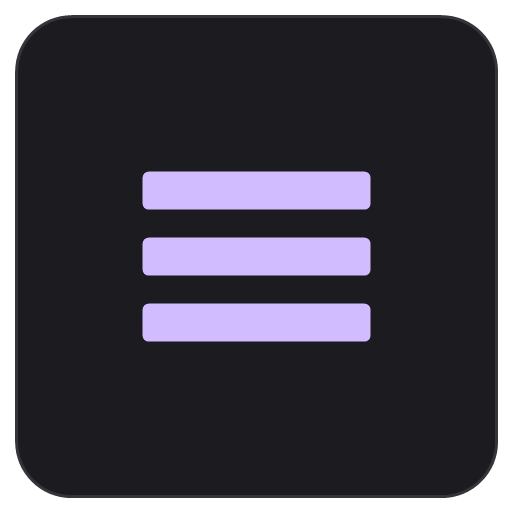

<p align="center">
  
</p>

<h1 align="center">Drawer</h1>

<p align="center"><strong>The intentional Android home screen built for peak focus, fluid speed, and zero clutter.</strong></p>
<p align="center">
  <em>Stop doom-scrolling through icon grids. Turn your phone back into a high-leverage productivity tool.</em>
</p>

<p align="center">
  <a href="https://github.com/urunkarpm/drawer/releases"></a>
  <a href="LICENSE"></a>
  
  
  
</p>

---

## 🎯 The 24-Hour Productivity Challenge

> **Install Drawer and use it for just one single day.**  
> If your phone doesn’t feel noticeably faster, less stressful, and dramatically less distracting within 24 hours, you can switch back with two taps. But once you experience a home screen that respects your attention and works at the speed of thought, you will never look at a standard launcher the same way again.

Most mobile launchers are designed like digital billboards: cluttered screens, recommended apps, unprompted news feeds, and chaotic notification badges competing for your dopaminergic attention.

**Drawer was built on a different philosophy: Intentionality.**  
Everything you need to get things done is reachable in under a second; everything else stays effortlessly out of your line of sight.

---

## 🌟 What's New in v2.10.1

* **🛡️ Calibrated Elastic Vault Swipe & Zero-Flick Trigger:**
  * Recalibrated the dock elastic resistance to trigger effortlessly with a natural ~28dp thumb swipe (reduced from 170dp), complete with dual haptic ticks and crisp confirmation pop.
  * Resolved an issue where triggering the vault mid-swipe caused the biometric prompt or vault drawer to flash for nanoseconds and immediately disappear due to finger lift-off touch collision.
  * Triggering now fires cleanly on swipe completion (`onDragEnd`), ensuring hands are off the glass before authentication opens.
  * Added touch event consumption (`clickable`) on the vault card surface to prevent clicks inside the vault from leaking through to the dismiss scrim.
  * Added a 250ms guard against accidental scrim touches during the entrance transition.
  * Locked `HorizontalPager` user scroll while the vault is active to eliminate page interference.

---

## 🌟 What's New in v2.10.0

* **🛡️ Hidden Drawer (Private Vault):**
  * Introduced a discreet, encrypted app vault triggered by swiping horizontally from the last app in the dock.
  * Elastic pull resistance physics with logarithmic damping and progressive tactile haptic ticks as you pull, confirming at the threshold breakpoint.
  * Secured via native Android `BiometricPrompt` with `BIOMETRIC_STRONG or DEVICE_CREDENTIAL` (fingerprint, face unlock, or device lock PIN/pattern).
  * Styled in Frosted Liquid Glass with hardware-conforming border radii, app launch, unhide, and app details actions.
* **🔒 Zero-Trace Privacy & Global App Isolation:**
  * Apps placed inside the vault are completely scrubbed from All-Apps drawers, category accordions, dock bars, and search queries.
* **🔔 Discreet Notification Privacy & Material You Ambient Glow:**
  * Notifications belonging to vaulted apps are suppressed from both the Notification Drawer and DuoStatus badges.
  * Subtle Material You breathing halo illuminates the drawer's notification bell icon for the first two device unlocks, alerting you discreetly without disclosing details or sender identities.
* **📱 Physical Display Curve Auto-Detection & Fine-Tuning:**
  * Automatically detects physical hardware display corner radius via Android 12+ `RoundedCorner` API (`WindowManager.currentWindowMetrics`).
  * "Match Device Screen Curve" toggle with live hardware detection telemetry in Settings.
  * Manual curve offset slider (`-12dp` to `+12dp`) to align drawer borders with phone cases and screen protectors.
* **🎨 App Drawer Visual Looks:**
  * Added selectable drawer look presets in **Settings -> Surface & Appearance -> App Drawer Look**: choose between **Solid**, **Liquid Glass**, and **Frosted Glass** satin diffusion.
* **🔙 Widget Drawer Outside-Swipe Return:**
  * Fixed an issue where swiping outside an expanded widget drawer did not return to the home screen.

---

## 🌟 What's New in v2.9.3

* **🧩 Widget Drawer Swipe Isolation:**
  * Fixed an issue where swiping horizontally through CoverFlow widgets inside an expanded widget drawer inadvertently triggered the root pager or page resistance and navigated back to the Home screen.
  * Nested horizontal drag and fling gestures are now cleanly isolated while any widget drawer is expanded.
* **🌊 Silky Smooth Drawer Expand & Collapse Animations:**
  * Resolved hitching, jitter, and abrupt snapping when expanding or collapsing category accordion drawers (such as Media and Notifications).
  * Replaced jarring hyper-stiff exit springs with fluid medium stiffness (`Spring.StiffnessMedium`) and synchronized 150ms alpha transitions.
  * Eliminated redundant double `bringIntoView` jumps and abrupt scroll clamping on collapse.
* **🔍 Search Bar Input Text Clipping Fix:**
  * Fixed an issue in the All-Apps drawer where text entered in the search bar had ascenders and descenders vertically cropped.
  * Configured explicit font styling, line-height constraints, and flexible minimum height to prevent clipping across all device densities and font scales.
* **📝 To-Do Sheet Keyboard Inset Handling:**
  * Fixed an issue in the To-Do task creation bottom sheet where the "+ Add Task" submit button was cropped behind the on-screen soft keyboard.
  * Added keyboard inset padding (`imePadding`) and scroll support (`verticalScroll`), allowing all form controls and actions to remain fully visible and accessible.

---

## 🌟 What's New in v2.9.2

* **📐 5 & 6 Column App Drawer (Enhanced Personalization):**
  * Added user-customizable app drawer column density: choose between **4, 5, or 6 columns** to match your device screen size and personal density preference.
  * Configurable in **Settings -> Surface & Appearance -> App Drawer Columns**.
  * Intelligently scales icon sizes, text labels, and grid gutters so higher densities remain legible, balanced, and easy to tap.
* **✨ Harmonized Suggested Apps Alignment:**
  * Suggested / frequent apps at the top of the app drawer now dynamically match your selected column count (4, 5, or 6 apps).
  * Equalized horizontal spacing and item widths guarantee that suggested apps align symmetrically with the drawer grid below.
* **☀️ High-Contrast Duo Status Pill on White Wallpapers:**
  * Resolved status icon legibility issues on pure white and high-luminance wallpapers.
  * Added adaptive wallpaper luminance detection, dual-layer outline shadow passes on canvas arcs, and an ultra-subtle protective glass capsule backing in collapsed mode.
  * Battery gauge, charging lightning bolt, volume meter, and percentage indicators stay razor-sharp and legible against any background.
* **⚡ Instant Notification Dismissal & Swipe Handling:**
  * Enhanced swipe-to-dismiss notification responsiveness with immediate optimistic state removal, preventing UI animation hitching.

---

## 🌟 What's New in v2.9.1

* **⚡ Instantaneous Outside-Click Drawer Collapse (0ms Latency):**
  * Eliminated the legacy 300ms–400ms double-tap gesture timeout delay when tapping outside to close expanded accordion drawers.
  * Added high-priority pointer-down interceptors across root bounds and columns, dismissing open category and notification drawers the exact millisecond the screen is touched outside.
  * Full-surface hit testing: tapping anywhere outside the active drawer (dock, glance clock/weather, empty wallpaper space, or other drawer headers) instantly snaps the drawer shut.
* **🧠 Synchronous In-Memory Optimistic State Engine:**
  * Replaced asynchronous SQLite disk I/O wait with immediate in-memory state overrides in `GroupsViewModel` and `HomeViewModel`, eliminating 100ms–200ms of database round-trip lag.
  * Room database updates now synchronize cleanly in the background.
* **🏎️ Snappy 3800f Spring Collapse Physics:**
  * Redesigned exit animations with high-stiffness springs (`stiffness = 3800f`) and fast 80ms fadeouts for razor-sharp, butter-smooth collapse transitions across category drawers, notifications, and widget stacks.

---

## 🌟 What's New in v2.9.0

* **📳 CrispHaptics Engine Across All High Touch Points:**
  * Native haptic feedback engine leveraging Android 11+ (API 30+) vibration primitives (`PRIMITIVE_CLICK`, `PRIMITIVE_TICK`, `PRIMITIVE_THUD`, `PRIMITIVE_QUICK_RISE`, `PRIMITIVE_QUICK_FALL`) with API 29 predefined effects and legacy View haptic fallbacks.
  * Tactile feedback integrated across the entire launcher: dock icon drags & slot boundary ticks, app drawer letter scrub rail, category drawer accordion toggles & casino reel shuffle, To-Do swipes & checkmarks, notification drawer gestures, status duo expand/collapse, and settings switches.
  * Master **Crisp Haptic Feedback** toggle in Settings under General to enable or silence haptics system-wide.
* **🔔 In-App Update Notifications & Smart Auto-Check:**
  * Automated background check on launcher startup, intelligently throttled to 24-hour intervals to preserve battery and respect GitHub API limits.
  * Clean in-app Material 3 update dialog displaying the latest release name, version tag, and full markdown release notes.
  * Non-intrusive **Later** option with version-specific dismissal memory so users are never repeatedly prompted for the same version.
  * One-tap **Download APK** / **Open Release** actions with instant browser or package installer redirection.
  * User-controllable **Auto-Check for Updates** switch in Settings under About Drawer / GitHub Updates.
* **✅ Native To-Do Engine, Location Alerts & Liquid Glass Task Analytics:**
  * Right-page gesture-driven to-do organizer with quick filter chips (*All*, *Nearby*, *Due today*, *Done*), custom deadline pickers, priority badges, and done task archives.
  * 100% de-Googled geofence & location alerts using native Android sensors and an offline-capable OpenStreetMap place picker.
  * Interactive Liquid Glass task completion & punctuality analytics.
* **🎨 Material You Dynamic Theming & Vibrant Color Palettes:**
  * Wallpaper-extracted dynamic theming with vibrant high-chroma palette options (Electric Amber, Vivid Cyan, Hot Rose, Violet, Neon Lime, Royal Azure, Sunset Orange) ensuring bold contrast on neutral wallpapers.
  * Edge-to-edge frosted glass backdrop blur behind the To-Do screen with zero separator line artifacts.

---

## 🧠 How Drawer Reclaims Your Focus & Time

```
  Traditional Launchers                     Drawer Launcher
 ┌──────────────────────┐                  ┌──────────────────────┐
 │ [App] [App] [App]  🔴│  Visual Clutter  │      09:41 AM        │  Glance Header &
 │ [App] [App] [App]  🔴│  Badge Overload  │  22°C ☀️  45W Turbo  │  Live Charging Stats
 │ [App] [App] [App]  🔴│  News Feed       │                      │
 │ ── Page 1 of 6 ──────│  Endless Swiping │ ┌──────────────────┐ │  Single Focus Area
 │ 🔍 Sponsored search  │  Ad Tracking     │ │ 📁 Work (4 apps) │ │  Expandable Drawer
 └──────────────────────┘                  │ └──────────────────┘ │
                                           │   [ 📞  💬  🌐 ]     │  Floating Glass Dock
                                           └──────────────────────┘
```

### 1. 🗂️ Accordion Drawers — Context-Driven Organization
Instead of spreading 80+ apps across 5 sprawling home screen pages, group your tools by your mental workflow:
* **Workflow Buckets:** Group apps into expandable categories like **`Deep Work`**, **`Communication`**, **`Finance`**, **`Learning`**, and **`Essentials`**.
* **One Tap Expands, One Tap Closes:** Expand only the drawer you need right now. Everything else stays collapsed, shielding your brain from visual overwhelm.
* **Multi-Drawer Versatility:** Need an app like Slack in both *Work* and *Chat*? Add it to both without duplicating shortcuts or wrestling with folder restrictions.
* **Smart Auto-Collapse:** Keeps your screen pristine automatically so you're never greeted by yesterday's mess.

### 2. 🪟 3D iPod Cover Flow & Expandable Widget Drawers
Widgets are powerful for productivity, but standard launchers force you to dedicate entire screen pages to them.
* **Cover Flow 3D Stacking:** Flip smoothly through interactive productivity widgets (Calendar, Tasks, Notes, Music) with tactile, physics-based depth.
* **Widget Accordion Drawers:** Tuck widgets into collapsible drawers. Pull up your day's schedule or task list with a tap, take action, and let it auto-collapse in 5 seconds.
* **Interactive Resizing:** Customize widget heights and grid spans to fit your exact information density requirements.
* **Bulletproof Engine:** Engineered with robust lifecycle hooks to prevent widget freezing and host memory leaks.

### 3. ⚡ Zero-Lag Launching & Smart Frecency Suggestions
When you know what you want to do, every millisecond of friction matters.
* **Frecency Predictive Row:** Surfaces your most relevant apps dynamically based on a smart frequency + recency calculation.
* **Instant Type-to-Filter:** Press a key and launch target apps in sub-milliseconds.
* **Thumb-Glide Alphabet Rail:** Slide your thumb down the screen edge to jump instantly to any letter index—effortless single-handed navigation on large devices.
* **Hidden Apps Vault:** Conceal apps you rarely need (or apps that trigger unhealthy habits) so you aren’t tempted by idle dopamine loops.

### 4. 🔕 Distraction Firewall — Notification Hub with Quick Mute
Notifications are the single biggest killer of deep work and flow state. Drawer puts you firmly in control:
* **Swipe-Up Notification Hub:** See incoming alerts neatly grouped by application—no chaotic notification shade pulling down over your workspace.
* **Home-Screen Quick Mute:** A chat group or noisy app breaking your concentration? Mute it for **1 hour**, **24 hours**, or **permanently** right from the launcher—without digging through system settings menus.
* **Privacy Mask Mode:** Instantly masks message previews on your home screen to keep sensitive work emails, two-factor codes, and private messages hidden from passersby.

### 5. 🔋 Live Power Stats, Quick Speed Test & Frosted Glass Dock
* **Live Battery & Fast-Charging Telemetry:** Tap the status icon to see real-time charging wattage (`W`), voltage (`V`), current (`mA`), battery temperature, and OEM fast-charging brand detection.
* **Dual-Stream Speed Test:** Run an instantaneous download speed test powered by Google Edge CDN and Cloudflare directly from the status popup.
* **Floating Glass Dock:** Pin 1 to 5 vital daily drivers (Phone, Browser, Notes, Terminal) in an elegant, blurred frosted glass bar.
* **Mirror Glance Widget:** Heading into an important video call? Tap the discreet front-camera glance right on your home screen to check your appearance without opening a heavy camera application.

### 6. 🛡️ 100% Offline, Ad-Free, & Zero Battery Drain
* **Zero Analytics & Trackers:** No cloud telemetry, no background pings, no accounts, and no data harvesting. 100% of your data stays on your device.
* **Pure 120Hz Smoothness:** Crafted in modern Jetpack Compose with optimized redraw cycles, true AMOLED black themes, and zero background battery drain.

---

## 📊 Stock Launchers vs. Drawer

| Capability | Stock / OEM Launchers | Nova / Third-Party | ✨ **Drawer** |
| :--- | :---: | :---: | :---: |
| **Mindset** | App Storefront & Feeds | Tweaker's Sandbox | **Intentional Productivity** |
| **Organization** | Rigid icons & nested folders | Complex grid layouts | **Accordion Drawers & 3D Stacks** |
| **App Predictions** | Ad/sponsored recommendations | Static recent apps | **On-Device Frecency Engine** |
| **Power Telemetry** | Basic percentage only | Requires 3rd-party apps | **Live Wattage, V/mA & OEM Turbo** |
| **Speed Benchmark** | ❌ None (ad-laden apps) | ❌ None | **Built-in Google Edge Speed Test** |
| **Distraction Defense** | Badges & push alerts | Basic badge toggles | **Home Screen Quick Mute & Privacy Mask** |
| **Widget Handling** | Screen hogging | Static placement | **Collapsible Widget Drawers & Cover Flow** |
| **Wallpapers & Fonts** | Fixed system defaults | Limited fonts | **Pantone Studio & Typography Packs** |
| **Privacy & Telemetry** | Cloud sync & ad analytics | Often tracks crash analytics | **100% Offline & Zero Telemetry** |
| **Setup Time** | Cluttered by default | 30+ minutes configuring | **Productive in under 60 seconds** |

---

## 🚀 Get Started in Under 60 Seconds

You don't need an hour to configure Drawer. It comes with an intuitive, guided onboarding tour and takes less than a minute to set up:

```
Step 1: Download & Install ───► Step 2: Set as Default ───► Step 3: Group by Intent
Download app-release.apk         Press Home → Drawer → Always       Create 3-4 Focus Drawers
```

### Option A: Install Pre-Built APK (Fastest)
1. Download the latest [`app-release.apk`](app-release.apk) directly from this repository or from the [GitHub Releases](https://github.com/urunkarpm/drawer/releases) page.
2. Open the downloaded file on your Android device and tap **Install**.
3. Press your **Home** button, select **Drawer**, and choose **Always**.
4. Follow the brief built-in welcome tour to configure your first drawers!

### Option B: Build from Source
If you are a developer and want to inspect the code or build it yourself:

```bash
# Clone the repository
git clone https://github.com/urunkarpm/drawer.git
cd Drawer

# Build the release APK with Gradle
./gradlew assembleRelease

# The compiled APK will be generated at:
# app/build/outputs/apk/release/app-release.apk
```

To install directly to a connected device via ADB:
```bash
adb install -r app/build/outputs/apk/release/app-release.apk
```

---

## 🎨 Visual Customization Options

Make your productivity workspace match your personal aesthetic:
* **Dynamic Pantone Wallpaper Studio:** Procedural wallpaper generator with customizable harmonies, duotones, and analog grain.
* **Curated Typography Packs:** Select your clock font from Google Sans, DS-Digital, Evil Empire, Hypik, Spookyy, and Texas Troupe.
* **App Label Scaling:** Fine-tune label text size across groups, dock, and all-apps drawer with `LocalAppLabelScale`.
* **Deep AMOLED Pitch Black:** Ultra-battery-efficient, high-contrast black styling.
* **Material You Dynamic Theming:** Automatically adapts accent colors based on your wallpaper.
* **Third-Party Icon Packs:** Full compatibility with icon packs from Google Play, plus per-app icon overrides.
* **Adaptive Shapes:** Choose squircle, circle, teardrop, or rounded square icons to maintain uniform geometry.
* **Double-Tap to Lock:** Double-tap any blank area to sleep your device cleanly without interfering with biometric face or fingerprint unlock.
* **One-Tap Backup & Restore:** Export your complete setup (drawers, widgets, icons, dock layout) to a portable file and restore it in seconds.

---

## 🏗️ Architecture & Tech Stack

For engineers and contributors, Drawer is engineered according to Google's official Modern Android Development (MAD) architecture:

```
├── app/                  # Main application module, navigation & initialization
├── core/
│   ├── common/           # Coroutine dispatchers, DrawerWidgetHostManager, utilities
│   ├── model/            # Pure domain models (AppDrawer, WidgetItem, DockItem)
│   ├── designsystem/     # Glassmorphic components, Pantone wallpaper, typography
│   ├── database/         # Room database, DAOs, and persistence entities
│   ├── datastore/        # Jetpack Preferences DataStore for user preferences
│   └── data/             # Repositories reconciling DB, installed apps & frecency state
└── feature/
    ├── home/             # Main screen orchestrator, DuoStatusIcon, speed test & walkthrough
    ├── groups/           # App drawer accordion management & categorized grouping
    ├── dock/             # Floating frosted glass dock & fast action bar
    ├── notifications/    # System notification listener, quick-mute & privacy masking
    ├── iconpacks/        # Icon pack parsing, caching & custom shape masking
    ├── todo/             # Gesture to-do engine, location alerts & task analytics
    └── settings/         # Visual customization, typography packs, backup & tour
```

* **UI Layer:** 100% Jetpack Compose with Material 3 design tokens.
* **Asynchronous Streams:** Kotlin Coroutines and reactive `StateFlow` / `SharedFlow`.
* **Predictive Algorithm:** On-device Frecency ranking reconciling launch count and timestamps.
* **Persistence:** AndroidX Room DB + Jetpack DataStore (zero raw SQLite/SharedPreferences).
* **Performance:** Hardware-accelerated graphics with RenderEffect runtime blur shaders (Android 12+) and legacy-safe fallbacks.
* **Network:** Standard platform `HttpURLConnection` for lightweight weather and update checks with zero third-party client bloat.

---

## 🤝 Contributing

We welcome community feedback, pull requests, and ideas!
* Found a bug or have a feature idea? Open an [Issue](https://github.com/urunkarpm/drawer/issues).
* Want to contribute code? Fork the repo, create a feature branch (`git checkout -b feat/my-enhancement`), and submit a Pull Request.

---

## 📜 License

Drawer is open-source software licensed under the [Apache License 2.0](LICENSE).
Your device, your data, your launcher.
