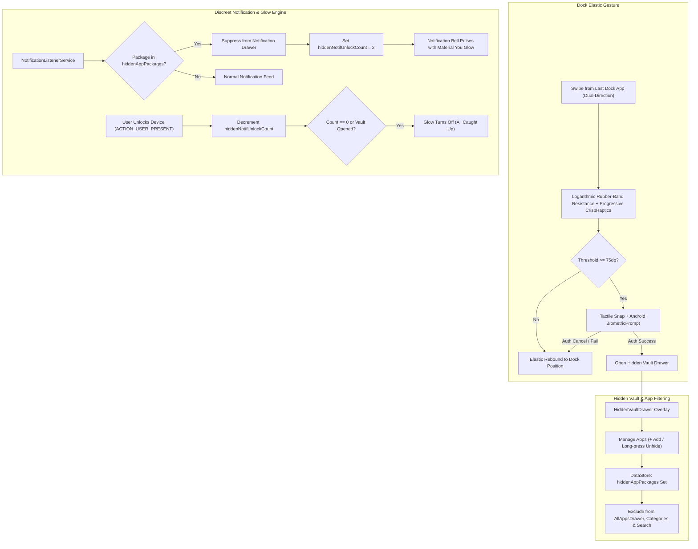

# Design Document: Hidden Drawer Vault & Discreet Privacy Engine

**Date:** 2026-11-14  
**Author:** Antigravity Team  
**Status:** Approved / Spec Review

---

## 1. Overview & Goals

The **Hidden Drawer Vault** provides a seamless, high-security space for sensitive applications on the user's home screen. Hidden apps and their incoming notifications are completely hidden from public view (main app drawer, category folders, search bar, dock, and notification list).

Access is achieved through a deliberate, tactile swipe gesture past the last app in the dock with physical rubber-band resistance, protected by Android Biometric / Device Lock authentication. Furthermore, whenever a hidden app receives an alert, the notification bell icon on the Notification Drawer quietly pulses with a subtle Material You ambient glow for the first two unlocks of the device, keeping notifications completely discreet.

---

## 2. Core Subsystems & Architecture

---

## 3. Detailed Component Specifications

### 3.1. Dock Elastic Gesture & Resistance (`feature:dock`)
- **Location**: In `DockBar.kt`, on the dock row containing `visibleApps`.
- **Gesture Detection**:
  - Detect horizontal drags originating on or beyond the last app slot (index `visibleApps.size - 1`).
  - Supports **Dual-Direction Flex**:
    1. Dragging rightward past the dock boundary stretches the entire dock or last icon with rubber-band tension.
    2. Swiping leftward specifically across the last slot engages magnetic pull tension.
- **Physical Resistance Formula**:
  $$\text{effectiveOffset} = \text{sign}(\text{drag}) \times \left(75 \times \left(1 - e^{-\frac{|\text{drag}|}{110}}\right)\right)$$
- **Progressive Haptic Cues**:
  - As drag increases: `crispHaptics.tick()` every 18dp of displacement with increasing intensity.
  - Crossing the 75dp threshold: `crispHaptics.confirm()` fires with a visual breakpoint latch highlight.
  - On release past threshold: triggers the authentication challenge.

### 3.2. Authentication Barrier (`feature:home`)
- **API**: Android `BiometricPrompt` via `androidx.biometric:biometric` or framework prompt.
- **Authenticators**: `BIOMETRIC_STRONG or DEVICE_CREDENTIAL` (permits Fingerprint, Face Unlock, or fallback to Device PIN / Pattern / Password if biometrics are unavailable).
- **Prompt Details**:
  - Title: "Unlock Private Vault"
  - Subtitle: "Verify identity to access hidden apps"
- **State Handling**:
  - Success: sets `isVaultOpen = true` and resets `hiddenNotifUnlockCount = 0`.
  - Failure/Dismissal: dock returns to rest position via `FluidSpringPhysics.fluidSpring()`.

### 3.3. Hidden Vault Drawer UI (`feature:home / component / HiddenVaultDrawer.kt`)
- **Surface**: Frosted Liquid Glass overlay adhering to `DeviceScreenCurve` hardware display corner radius.
- **Header**:
  - Privacy shield icon and "Private Vault" title with app counter badge.
  - Action row: Search filter, **"+ Add Apps"** action button, and close/lock button.
- **App Grid**:
  - Displays all apps whose package names are in `hiddenAppPackages`.
  - Single tap: launches the private app.
  - Long press / dropdown:
    - "Launch"
    - "Unhide App" (removes from `hiddenAppPackages`)
    - "App Info"
- **Add Apps Sheet**:
  - Searchable picker listing non-hidden installed applications with checkboxes.
  - "Hide Selected Apps" button updates `hiddenAppPackages`.

### 3.4. Global App Filtering (`core:data`, `core:datastore`, `feature:home`)
- **DataStore Storage** (`DrawerPreferencesDataSource.kt`):
  - `stringSetPreferencesKey("hidden_app_packages")`
  - `intPreferencesKey("hidden_notif_unlock_count")`
- **Exclusion Points**:
  1. **AllAppsDrawer**: `allApps.filter { it.packageName !in hiddenAppPackages }`
  2. **Category Drawers**: `groupsUiState.groups.map { group -> group.copy(apps = group.apps.filter { it.packageName !in hiddenAppPackages }) }`
  3. **Drawer Search**: Search filtering explicitly excludes hidden package names.
  4. **Dock & Suggestions**: Suggested apps and dock recommendations ignore hidden packages.

### 3.5. Discreet Notification & Bell Glow Engine (`feature:notifications`)
- **Suppression in `NotificationListenerService`**:
  - In `NotificationsViewModel` / `NotificationCollector`:
    - Checks incoming `StatusBarNotification`. If `sbn.packageName in hiddenAppPackages`, it is discarded from active lists.
    - Suppressed notifications are stored in a private `hiddenActiveNotifications` state flow accessible only by the Vault.
    - Sets `hiddenNotifUnlockCount = 2`.
- **Unlock Lifecycle Receiver** (`UnlockReceiver.kt`):
  - Broadcast receiver registered for `Intent.ACTION_USER_PRESENT`.
  - Decrements `hiddenNotifUnlockCount` by 1 per unlock down to 0.
- **Notification Bell Glow in `NotificationDrawer.kt`**:
  - When `hiddenNotifUnlockCount > 0`:
    - The `Icons.Default.NotificationsNone` or notification icon badge on the Notification Drawer header acquires an active breathing glow:
      - Radial halo with `MaterialTheme.colorScheme.primary.copy(alpha = animatedAlpha)` (pulsing between 0.25f and 0.85f).
      - Subtle scale pulse (1.0f to 1.12f) with 1400ms duration and smooth sine easing.
    - Header text stays innocuous ("All caught up" or standard alert count).

---

## 4. Edge Cases & Resilience

1. **No Biometric Enrolled**:
   - `BIOMETRIC_STRONG or DEVICE_CREDENTIAL` falls back cleanly to the system PIN, pattern, or password without crash or lockout.
2. **Package Uninstallation**:
   - When an app is uninstalled from the device, `PackageChangeReceiver` automatically cleans up dead package names from `hiddenAppPackages`.
3. **App Pinned to Dock when Hidden**:
   - If an app pinned to the dock is added to the hidden vault, it is automatically unpinned from the dock to maintain secrecy.
4. **Backup & Restore**:
   - `hiddenAppPackages` is included in `LauncherBackup` so users don't lose their vault configuration on device migration.

---

## 5. Verification Plan

- **Unit Tests**:
  - `DrawerPreferencesDataSourceTest`: Validate adding, removing, and persisting hidden app packages and decrementing the unlock budget.
  - `HomeViewModelTest`: Verify hidden packages are filtered from `allApps`, category groups, and search results.
  - `NotificationsViewModelTest`: Verify notifications from hidden packages are suppressed and properly set `hiddenNotifUnlockCount = 2`.
- **Instrumentation & Hardware Tests**:
  - Verify dock resistance curve and haptics on physical test device (`192.168.1.8:36265`).
  - Test BiometricPrompt appearance and authentication success/cancel paths.
  - Verify bell glow pulses on unlock 1 and 2, and turns off on unlock 3 or upon opening the vault.
